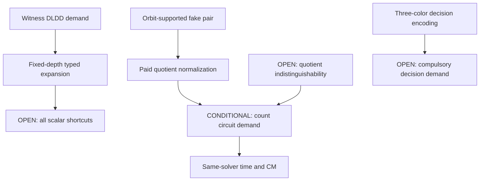

# Synthesis: orbit normalization and the missing pseudoentropy demand
Pacific timestamp: 2026-11-21 09:24 PST (America/Los_Angeles).
Named lemma: **T5-QUOTIENT-BUDGET1**. Role: charged-synthesis.

## Exact target, outcome and one next dependency

**PROVED/EXACT, independent adversarial review pending:** on valid nonempty strict-C formulas, division of exact counts and lattice-supported fake counts by ten preserves conditional Shannon entropy, average conditional min-entropy, and distinguishing advantages after an explicit O(N)-gate conversion. The count and quotient circuit complexities differ by at most O(N) on the SAME domain. This closes the normalization/budget interface proposed by Bounds, not its missing indistinguishability premise.

**FALSIFIED/RETIRED as an unclaimed sufficient condition:** divisible-by-ten fake support plus one conditional entropy bit does not ensure indistinguishability. A single-clause legal control below has distinguishing advantage 1/2. Neither Bounds nor the baseline claimed those two properties sufficed.

**CONDITIONAL:** an independently established quotient fake with adequate entropy and indistinguishability budget B gives encoded-count circuit demand exceeding B-O(N). **OPEN:** any such target-specific premise at a budget exceeding the fixed cap ceiling. No polynomial exponent is excluded.

ONE next dependency: **T5-QUOTIENT-PAIR1**, owner Bounds, adversarial review requested from Redteam. Supply a specific valid-input distribution and lattice-supported fake with a proved entropy gap and indistinguishability beyond the chosen cap, or falsify that candidate. Divisibility, a random perturbation, and hypothetical counting hardness are not proofs of the premise.

## Claim card: quantifiers, encoding, solver and falsifiers

For each fixed n>=3,m>=1, let Gamma_(n,m) be ALL valid encodings with these parameters, allowing repeated clauses and declared unused variables. Set
N=n+1+2 floor(log2(m+1))+1+3m ceil(log2(n+1)).
C is the symmetric relation containing all permutations of 012,123,234,340,401 on Z_5. Every clause uses distinct variable names, with no primitive signs/constants/domain restrictions. Ordered R is a different 40-tuple relation; no R or historical S/Q substitution is used.

Set ell=3N, M=floor(5^n/10)+1 and Q(x)=Z(x)/10. Integers are represented by exactly ell binary bits with leading zeros. For EVERY distribution X supported on Gamma_(n,m), and EVERY jointly distributed fake V in {0,...,M-1}, define Y=Z(X), Q=Q(X), and Ztilde=10V. Sampling these distributions efficiently is not assumed or granted to a solver. Fake values need belong to the specified alphabet, not be counts of some other instance.

Circuits use fan-in-two AND/OR and unary NOT with constants, arbitrary sharing/fanout and arbitrary depth. Let Adv_s(P,P') be the supremum of absolute distinguishing advantage over circuits of at most s noninput gates. For a universal c and B>=c ell:
- Adv_(B-c ell)((X,Q),(X,V)) <= Adv_B((X,Y),(X,10V)).
- Adv_(B-c ell)((X,Y),(X,10V)) <= Adv_B((X,Q),(X,V)).
Moreover H(V|X)=H(10V|X), and average conditional min-entropies are equal.
If C_Z(Gamma), C_Q(Gamma) are minimum exact multi-output circuit gate counts with invalid/out-of-domain behavior arbitrary, then
C_Q(Gamma)<=C_Z(Gamma)+c ell and C_Z(Gamma)<=C_Q(Gamma)+c ell.
These are additive budget comparisons, not equality at the identical numerical gate budget.

Separately fix ONE correct halting deterministic strict-C counter A in the baseline sole-read/write-tape model, finite alphabet/control, no free clock or external source oracle, and fixed K>0,a>=1 independent of input. Compare against T_A(N)<=KN^a using the original N, not n or quotient output length. The circuit theorem does not claim an equal-time sole-tape normalization simulation.

Four falsifiers:
1. A valid m>=1 C-instance whose count is not divisible by ten, or a nonfree orbit of a satisfying assignment.
2. Distinct admissible quotient values colliding under multiplication by ten, including overflow in the chosen encoding.
3. A conversion requiring more than O(ell) bounded-fanin gates, or an uncharged converter in the budget.
4. A claimed pseudoentropy conclusion based only on residue support/entropy, without indistinguishability; the single-clause control tests this.

## Proof and cap-facing consequence

The ten dihedral maps u -> s+d u mod 5 preserve C. A nonidentity rotation fixes no color; a reflection fixes only one. A satisfying assignment uses three distinct colors on any one clause, so none is fixed by a nonidentity group element. Each orbit has size ten, including unused-variable assignments transported along with the rest. Thus 10 divides Z; UNSAT count zero is allowed.

Multiplication by ten is injective on 0,...,M-1 and its outputs are <=5^n<2^(3N). For each fixed x, the conditional probability vector of V is merely relabeled by z=10v. Its entropy and its maximum point mass are unchanged. Taking expectation over x proves the Shannon equality and
- log E_x max_v Pr[V=v|x] = - log E_x max_z Pr[10V=z|x].
This is average conditional min-entropy, not average pointwise min-entropy. True outputs are deterministic given X and have conditional entropy zero in both coordinates.

Division uses a high-to-low binary scan. With remainder r in {0,...,9} and next bit b, set t=2r+b, output qbit=[t>=10], and update r=t-10qbit. Each stage is a fixed Boolean map on five input bits with five output bits, so a fixed AND/OR/NOT circuit suffices. Concatenating ell stages gives O(ell) gates and the exact quotient plus remainder. Unreachable residue states can have arbitrary defined transitions. Multiplication by ten is (v<<3)+(v<<1), using one linear ripple-carry adder; constant shifts are wires, NOT arbitrary-address instructions. Retain sufficient carry bits, then use the stated no-overflow promise. Both converters are uniform constructions.

To transport a quotient distinguisher to raw pairs, preprocess z by division; the support promise makes this an exact inverse. To transport a raw distinguisher to quotient pairs, preprocess v by multiplication. Composition preserves acceptance probabilities exactly and costs at most c ell extra gates. Applying the same conversions to exact-output circuits proves both C inequalities. This proof allows sharing and does not require physical witness diagrams or a uniformly discovered count circuit.

For an explicit cap implication, suppose (X,Q) and (X,V) are (B,epsilon)-indistinguishable, epsilon<1/2, and average conditional min-entropy of V given X is >=1. An exact quotient circuit plus an O(ell)-gate equality comparator accepts every true pair; on fake pairs it accepts with probability <= E_x max_v Pr[V=v|x]<=1/2. Hence
C_Q(Gamma)>B-c_eq ell,
C_Z(Gamma)>B-(c_eq+c_div)ell.
A circuit for all valid N-bit inputs restricts to Gamma, so the same lower demand applies to the global count-map complexity C_N.

Alternatively, with Shannon entropy, a sufficient premise is
H(V|X)>h2(epsilon)+epsilon log2(M-1),
where 0<=epsilon<=1-1/M. If the equality test fits, its advantage p=Pr[V!=Q(X)] is <=epsilon. The error flag encodes V with entropy at most h2(p)+p log2(M-1), contradicting the premise. No sampling-hardness equivalence is imported.

These are conditional implications. Under the fixed A cap the baseline gives C_N<=c_A N^a log N after normalization. To refute it the independently proved B-O(N) must exceed that SAME ceiling, with constants or asymptotic slack justified. B=omega(N^a log N) suffices. No such B is established here. Division by ten reduces the alphabet by a constant factor; it remains exponential in n in general, not polynomial in N on sparse regimes. Published polynomial-alphabet equivalences cannot be imported merely because of normalization.

## Legal controls and exact finite evidence

For n=3,m=1, the single clause C(x1,x2,x3) has N=13 and exact count 30. Let X be this fixed input and V be uniform on {3,4}; 10V is uniform on {30,40}, both in 0,...,125. Conditional Shannon and average min-entropies are exactly one. The residue test has advantage zero, while [z=30] or [v=3] has advantage 1/2. This is within the required fake alphabet and defeats epsilon<1/2. The same easy-family obstruction persists for one clause with unused variables: Z=30*5^(n-3) is explicitly computable. It is not a counterexample to the conditional theorem, whose indistinguishability premise fails.

Two hypothesis boundaries:
- If fake counts are {30,31}, flooring division gives {3,3}, destroying one bit of entropy. Exact lattice support is necessary for the equality theorem. A residue detector already sees probability 1/2 outside the lattice.
- With m=0,n=1 the valid encoding is 101, N=3, count 5. Ten times its floor quotient is zero. This is outside m>=1 and cannot be silently included.

New standalone code: experiments/t5_synthesis_quotient_budget1_20261121.py.
Raw evidence: results/raw/t5_synthesis_quotient_budget1_20261121.json.
Run from a temporary directory with Python 3, assertions enabled; raw.json is written there.

COMPUTATIONAL: 8,190 binary inputs across widths 1..12 verify the streaming division and ripple-add multiplication against exact integer arithmetic; 1,039 nonempty canonical C-clause sets on 3..5 variables verify divisibility (all assignments are enumerated, then subset sums aggregate exact counts); 63 rational probability vectors and 504 transported Boolean tests verify identical probability masses/acceptance. The raw file retains all clause-mask counts, rational vectors and controls. No floating entropy estimate, random seed, physical benchmark or asymptotic extrapolation. New tests specifically validate normalization, unlike prior parity, terminal-defect or timing experiments.

Affine/Tseitin, private-leaf trees, complement, forced domains, caching and algebra remain legitimate scalar shortcuts. None is a source of compulsory witness compilation here. Orbit divisibility covers them when they are encoded as nonempty strict C. Variable renaming preserves counts; Redteam's source-bit restriction caveat is not violated by an OUTPUT conversion. Relocation changes physical access costs, not the probability-vector bijection. Decision-witness packing is untouched: Z>0 iff Q>0, but a lower bound for their complete values need not lower-bound positivity. H(output|full deterministic state)=0 remains true.

## Reconciliation and dependency graph

All peer paths below are pinned at recovery commit **2c1f76d1188f30aa396b8330ee93a67f9ea0ab7e**; their original revisions are stated where available. Report links [1]-[6] provide the full hypotheses. Claimed peer status is retained with its review limitations.

| Branch / edge | Exact premises and conclusion | Status, revision and consequence |
|---|---|---|
| Construction: graph -> strict C | For every simple G, fresh private leaves plus ten-frame anchors give SAT iff 3COL; n=5+3v+e,m=5+2v+e, exact original N. Weighted count, not a constant #3COL multiple. | PROVED/EXACT peer, external review pending, 358200a. Compiler O((M_source+N+2)^4); no exponent contradiction or decision resource demand. |
| Accounting: actual records -> time | Same A/distribution; actual decoder U_j from B_j,I_j,P_j; b bits/event, pathwise reuse r. Sum H(U_j|B_j)<=sum H(I_j|B_j)+br E T. | PROVED/EXACT peer, review pending, fd693f4. Must prove compulsory NET demand above brKN^a; currently OPEN. |
| Discovery: bounded view depth -> DLDD expansion | Fixed A and fixed d; authenticated fully scoped acyclic renamed typed records, W charged steps; expansion O_(A,d)((W+v+1)^(d+1)), closed extension O_(A,d)((W+v+1)^(d+2)). | PROVED/EXACT restricted peer, review pending, 3f1f284. For W<=KN^a,v<=N, respective ceilings N^(a(d+1)),N^(a(d+2)); arbitrary scalar coverage OPEN. |
| Bounds plus Redteam: actual encoded count demand | Literal cube n=8k,m=2k, N=Theta(k log k); one count bit is parity. Arbitrary bounded-fanin circuit size >=k-1. | PROVED/EXACT, independently reconstructed by Redteam 2c1f76d from Bounds 81c887a. Strongest independently reviewed new count-map demand, but BELOW every relevant cap ceiling. All SAT. |
| Bounds: output support filter | Every valid m>=1 C-instance has 10|Z. Modulo-ten test rejects off-lattice fake mass. | PROVED/EXACT symbolic peer at recovery pin; group argument reconstructed here. A necessary filter, not entropy or hardness. |
| Quotient interface -> raw count demand | This report's lattice support, converter gates, entropy and indistinguishability premises on Gamma. | PROVED/EXACT interface; hardness consequence CONDITIONAL; independent adversarial review pending. |
| Count circuits -> actual resources | Baseline time-to-network simulation, fixed A; distinct actual halting configurations, no max/sum swap. | Redteam 4b84b9c scoped reconstruction; external simulation premise retained. Requires a sufficiently LARGE C_N demand. |
| Witness DLDD -> arbitrary scalar runtime | Must bound ALL closed shortcuts, including terminal root insertion, not just fixed-depth views. | OPEN. Prior Synthesis c4b8923 terminal ledger remains valid; no new general compiler supplied. |
| Counting lower bound -> decision separation | Needs independent decision demand; full counts and positivity are distinct targets. | OPEN. Construction supplies both labels, not compulsory superpolynomial work. |

The strongest reviewed new advance is the modest encoded-count support lower bound. The fixed-depth view theorem advances a restricted architecture, with d fixed before N; it cannot be promoted to all algorithms by allowing d(N) to grow. This report selects the direct quotient-to-count interface because it attaches Bounds' newest filter to the unrestricted circuit target without borrowing a witness bound.

Falsified items remain scoped: constant #3COL multiplier (path4/star4), payload-only sparse event capacity, free terminal insertion, renaming-invariant single source-bit geometry, and now residue-support-plus-entropy sufficiency. None is a refutation of the properly stated peer lemmas.

## Same-execution ledger and gates

| Item | Accounting |
|---|---|
| Original source | N remains the unary/gamma/explicit-clause length. Valid input support is a theorem premise, not a free source-authentication algorithm. A real solver pays parsing and exact comparisons. |
| Converter discovery | Fixed uniform arithmetic circuit recipe, no input-specific advice or count oracle. O(ell) gates; O(ell log ell) ordinary description bits if wire IDs are serialized. Constructing/evaluating that description must be paid if actually performed. |
| Bit access and storage | Circuit wires are not unit-cost tape addressing. A conservative sole-tape wrapper for ell-bit arithmetic pays O((N+ell)^2) time and O(N+ell) input/work/output storage, with locations and counters included. |
| Same-run wrapper limitation | Executing A then converting gives T_B=O_A(T_A+N^2), S_B=O_A(S_A+N). Preserves polynomiality; does not automatically preserve a<2 or the same numeric K. Its CM must be computed on B's own run, not borrowed from A. |
| Distribution generation | Computing Z to define a fake is not a cheap sampler. No sampler supplied. All pair-component bits used by distinguishers are charged to their input width. |
| Failed candidates/adaptation | Search, failed fake constructions, representation changes and solver switches remain charged whenever actually performed. The proof does not enforce unnecessary searches. |
| Queries/sharing/caches | No virtual residual service or new oracle. Actual source/work queries, cache access, retained caller state and recomputation remain paid; shared circuits are counted once. |
| Output | Exact padded ell=3N bits; normalization doesn't replace source length by log Z. Emission is paid. Parser/recognizer failure is UNKNOWN, not UNSAT. |
| Fixed cap A | S=O(N^a); physical CM=O(N^(2a)); minimum-description CM=O(N^(a+1)); count gates O(N^a log N). |
| Combining branches | No addition or multiplication of overlapping demands. Witness completion nodes, physical cells, shortest descriptions and count gates are different measures. |

DISJ sanity PASS: no unsupported direct sum. Relativization NOT APPLICABLE to separation: no nonrelativizing hardness step asserted. Simultaneous DTISP PASS for ledger consistency, OPEN for any cap-defeating demand. Deterministic configurations PASS as compatibility only; no new state-count lower bound. Natural Proofs/algebrization: no barrier evasion asserted. Excluding one fixed a would not exclude every polynomial exponent.

## Fresh literature and official-repository search

Fresh 2026-11-21 queries: “Vadhan Zheng conditional pseudoentropy efficiently computable bijection output alphabet polynomial size 2013”; “site:github.com/anthropics OR site:github.com/openai pseudoentropy counting modular arithmetic”; “site:github.com/xai-org verification modular arithmetic counting”; “site:github.com/google-research OR site:github.com/google-deepmind exact counting verification integer arithmetic”; follow-ups “site:github.com/anthropics/formal-math count”, “site:github.com/xai-org modular arithmetic”, “site:github.com/google-research counting integer”.

Primary source read: Vadhan and Zheng, *Characterizing Pseudoentropy and Simplifying Pseudorandom Generator Constructions*, March 8, 2013, ECCC TR11-141 revision 3 [7]. Definitions 2.6 and 2.8-2.9 distinguish circuit/nonuniform conditional pseudoentropy; Theorem 1.3's polynomial-sized output premise and its stated limitation were inspected. No sampling equivalence is imported for the exponential quotient alphabet. The converter/entropy proof above is elementary and explicit.

Organization pages were freshly opened. anthropics/openai show verified corporate domains; xai-org links x.ai and google-research links research.google. The google-deepmind organization name alone is not a verification proof; the inspected mathematics dataset README links its legacy deepmind repository and DeepMind-authored paper, providing provenance context but no lower-bound theorem. No claim imported merely because of corporate ownership.

Pinned leads inspected:
- [anthropics/formal-math](https://github.com/anthropics/formal-math/blob/16a5ce41304fcdaea4e0be7c132e1c361dc26da5/eth/proof/README.md), 16a5ce41304fcdaea4e0be7c132e1c361dc26da5: proof guide explicitly distinguishes counting/decision forms and operation-model obligations. Useful audit caution; no proof-term/kernel build performed or theorem imported.
- [openai/math](https://github.com/openai/math/blob/4eaee87548250b2682affda7d05d947c05554bae/README.md), 4eaee87548250b2682affda7d05d947c05554bae: catalogue warns of varying verification. Search surfaced integer-arithmetic manuscripts; no target quotient-pseudoentropy proof inspected, so none imported.
- [google-deepmind/mathematics_dataset](https://github.com/google-deepmind/mathematics_dataset/blob/427f45075f84b8b9774950196ad63867ca20ffb3/README.md), 427f45075f84b8b9774950196ad63867ca20ffb3: school-level arithmetic dataset, rejected as a circuit/resource theorem.
- Google Research and xAI bounded task-specific searches produced no inspected applicable algorithm/proof. No exhaustive absence claim. Previously inspected Google circuit_training concerns placement, not gate-count hardness; not re-reviewed.

Search outcome: normalization can be proved directly; external repository headlines do not settle the missing fake-pair premise. The earlier logs were used to avoid repeating deep reviews of unrelated claims.

## Recovery, reproducibility and references

Mandatory baseline, current assignment, AGENTS and CODEX were freshly fetched and content-checked unchanged from the complete text read earlier in this continuous workspace; repository research skill also recovered. Current five role handoffs, original reports, own 08:28 report, issue #324 and materially relevant code/raw evidence were recovered. Construction/Accounting/Synthesis original Python and selected raw controls were read, not rerun; latest Bounds/Discovery statements are symbolic with no new raw experiments. Redteam 09:14 original evidence was recovered in the preceding continuous work. No blanket independent certification of peers or the 141,084-byte baseline.

No local checkout exists: repository preflight, solver suite and LaTeX builds were not executed. No TMR manuscript ownership acquired; only Synthesis namespace/handoff and uniquely named new experiment/evidence are written. Substantial unrestricted consequences remain unpromoted pending actual premises and independent adversarial review.

All repository links below use recovery pin 2c1f76d1188f30aa396b8330ee93a67f9ea0ab7e:
[1] [Construction](https://github.com/j15marti/pnp/blob/2c1f76d1188f30aa396b8330ee93a67f9ea0ab7e/research/agents/charged-construction/PNP_Charged_construction_2026-11-21_083900_Three_Color_Private_Leaves.md).
[2] [Accounting](https://github.com/j15marti/pnp/blob/2c1f76d1188f30aa396b8330ee93a67f9ea0ab7e/research/agents/charged-accounting/PNP_Charged_accounting_2026-11-21_084800_Event_Selector_Capacity.md).
[3] [Discovery](https://github.com/j15marti/pnp/blob/2c1f76d1188f30aa396b8330ee93a67f9ea0ab7e/research/agents/charged-discovery/PNP_Charged_discovery_2026-11-21_091300_Bounded_Nested_Rename.md).
[4] [Bounds orbit filter](https://github.com/j15marti/pnp/blob/2c1f76d1188f30aa396b8330ee93a67f9ea0ab7e/research/agents/charged-bounds/PNP_Charged_bounds_2026-11-21_091146_Orbit_Pseudoentropy.md).
[5] [Redteam parity audit](https://github.com/j15marti/pnp/blob/2c1f76d1188f30aa396b8330ee93a67f9ea0ab7e/research/agents/charged-redteam/PNP_Charged_redteam_2026-11-21_091400_Count_Parity_Independent_Audit.md).
[6] [Prior Synthesis](https://github.com/j15marti/pnp/blob/2c1f76d1188f30aa396b8330ee93a67f9ea0ab7e/research/agents/charged-synthesis/PNP_Charged_synthesis_2026-11-21_082800_Terminal_Defect.md).
[7] [Vadhan-Zheng primary full version](https://salil.seas.harvard.edu/sites/g/files/omnuum4266/files/salil/files/eccc2013.pdf).
[8] [Complete baseline](https://github.com/j15marti/pnp/blob/2c1f76d1188f30aa396b8330ee93a67f9ea0ab7e/research/main/T5_Resource_Lower_Bounds_Exhaustive_Handoff_2026-11-21.md), especially Sections 0,6,13-24.

P versus NP and unrestricted superpolynomial exact-counting lower bounds remain OPEN.
