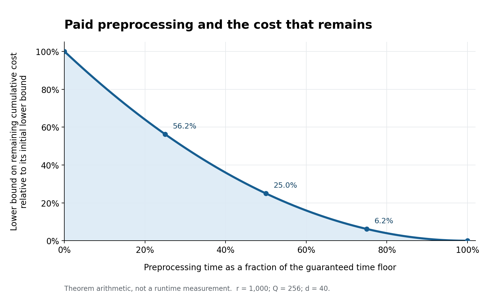

# Charged UNSAT computation after preprocessing: a pointwise theorem at every checkpoint

**Research date:** 21 November 2026, America/Los_Angeles.  
**Named result:** CHARGED-UNSAT-PREPAYMENT1.  
**Target:** Strengthen the existing minimum-distinguishable-information argument into an explicit bound on computation remaining after arbitrary paid preprocessing.  
**Status:** PROVED/EXACT for the deterministic single-tape model, ordered input family, prefix-description measure, and splicing premises stated below. Unrestricted superpolynomial SAT lower bounds remain OPEN.  
**Review:** Three collaborating agents independently audited the pointwise derivation and the direct-code refinement. This is internal mathematical review, not external peer review or a proof-assistant kernel verification. No historical novelty is claimed for the crossing method or elementary coding principles.

## 1. What is strengthened

The previous report established whole-run lower bounds on an explicit UNSAT family:

\[
T=\Omega_A(N^2),\qquad CM_{\min}=\Omega_A(N^3),\qquad
CM_{\mathrm{phys}}=\Omega_A(N^3).
\]

The present result identifies how much of that obligation remains after the solver has already computed for an arbitrary number of transitions. On one large set of UNSAT inputs, it holds simultaneously at every checkpoint of each actual execution, including checkpoints chosen adaptively or retrospectively.

Let \(\tau\) be transitions already paid, and let \(M_{>\tau}\) be the remaining minimum-description cumulative cost. The principal explicit bound is

\[
\boxed{
M_{>\tau}\ge
\Delta\,\Phi_\ell\!\left(H-\frac{\ell\tau}{\Delta}\right),
\qquad
\Phi_\ell(z)=\sum_{j\ge1}(z-j\ell)_+.
}
\tag{1}
\]

Here \(\Delta=\Theta(N)\) is the number of selected physical boundaries, \(\ell\) depends only on the fixed solver's state count, and \(H=\Theta(N)\) is an explicit information threshold. A useful consequence is

\[
\boxed{
\tau+\sqrt{\frac{2\Delta M_{>\tau}}{\ell}}
\ge \frac{\Delta H}{\ell}-\Delta.
}
\tag{2}
\]

Thus reducing the remaining cost requires substantial computation already paid on the same input. The proof allows preprocessing, caching, global algebra, representation changes, and source relocation. It does not require a solver to follow the proposed variable-erasure schedule or recompute an answer that it already knows.

There is also an exact discrete refinement and an execution potential whose decrease at each transition is bounded by the cost of that transition. These make the accounting noncircular and prevent repeated charges for the same event.

The current family's matching polynomial algorithm remains valid. The strengthened theorem retains the quadratic and cubic scales; it does not supply an unrestricted superpolynomial separation.

## 2. Fixed model and same-execution resources

Fix one total correct deterministic SAT decider \(A\). It has one physical writable tape, one head, a fixed finite alphabet, and \(Q\ge2\) control states. Each transition moves the head by at most one cell. Input, workspace, addresses, and output occupy that tape. The canonical output and terminator start at a fixed origin. There is no independently moving input head, original-input oracle, external workspace, or unrecorded clock affecting continuation.

Let \(C_t\) be the complete configuration after transition \(t\). Let \(s_t\) be one plus the length of the smallest interval containing the origin, head, and all nonblank cells, converted to bits with a fixed factor. The complete state has a faithful encoding of size \(O_A(s_t)\).

Fix the same prefix-universal description machine \(\mathcal U\) as in the preceding report. Define

\[
CM_{\min}^{>\tau}
=\sum_{t=\tau+1}^{T_A}K_{\mathcal U}(C_t\mid A),
\qquad
CM_{\mathrm{phys}}^{>\tau}
=\sum_{t=\tau+1}^{T_A}s_t.
\tag{3}
\]

The input, time, family parameter, and crossing transcript are not free side information in \(K_{\mathcal U}(C_t\mid A)\). The descriptions need not be efficiently discoverable or decodable. They define an information measure, not a second implementation.

There is a fixed constant \(\lambda_A\) such that

\[
K_{\mathcal U}(C_t\mid A)\le\lambda_A s_t.
\tag{4}
\]

An additive coding constant is absorbed because \(s_t\ge1\). Consequently every suffix minimum-description lower bound gives a physical cumulative lower bound divided by \(\lambda_A\).

The classical crossing technique is supported by the primary papers of Hennie and Hartmanis. Their model restrictions matter. The checkpoint tradeoff proved here is derived from the project's explicit construction and splicing lemmas, not attributed to those papers. [1,3,4]

## 3. The explicit opposite-label family

For \(r\ge3\) and permutations \(\pi,\sigma\in S_r\), begin with

\[
F^0_{\pi,\sigma}
=\bigwedge_{i=1}^{r}(\neg X_i\lor Y_{\pi(i)})
\land\left(\bigvee_{i=1}^{r}X_i\right)
\land\bigwedge_{i=1}^{r}(\neg X_i\lor\neg Y_{\sigma(i)}).
\tag{5}
\]

This formula is UNSAT exactly when \(\pi=\sigma\). Equality makes every possible true \(X_i\) force contradictory values on one \(Y\). For unequal permutations choose an index \(i\) with \(\pi(i)\ne\sigma(i)\), set just \(X_i\) true, and give those two distinct \(Y\) coordinates the required opposite values.

Replace each binary clause \(C\) by \((C\lor p)\land(C\lor\neg p)\), with one shared fresh \(p\). Replace the long OR with its standard proper-3-CNF chain. This gives \(n_0=3r-2\) variables and \(m_0=5r-2\) clauses.

Apply the adjacent-witness compiler. Add

\[
P(y,u,v)=\bigwedge_{\epsilon,\delta\in\{+,-\}}
(y\lor\epsilon u\lor\delta v),
\]

which is pointwise equivalent to \(y\). Replace every source clause \((a\lor b\lor c)\) with

\[
(\neg y\lor a\lor z_C)\land(\neg z_C\lor b\lor c).
\]

Existential projection over the helpers gives \(y\land F^0_{\pi,\sigma}\). The target has

\[
n=8r-1,\qquad m=10r.
\tag{6}
\]

The assignments \(\alpha\), with only \(u=1\), and \(\beta\), with only \(u=v=1\), differ in one bit. Each falsifies exactly one clause of the whole target. The Horn part is satisfied by \(\alpha\), and the dual-Horn part by \(\beta\). Both labels of the source family preserve these properties. [1]

Use the exact ordered encoding

\[
1^n0\;\Vert\;\gamma(m+1)\;\Vert\;
\text{signed clause triples}\;\Vert\;\alpha\;\Vert\;\beta\;\Vert\;y_{\rm ID}.
\]

With \(w=\lceil\log_2(8r)\rceil\), its length is

\[
N=3n+2+2\lfloor\log_2(m+1)\rfloor+3m(w+1)+w
=\Theta(r\log r).
\tag{7}
\]

The prescribed clause order gives

\[
I_{\pi,\sigma}=L_\pi\,M_r\,R_\sigma,
\]

where the common middle has \(6(r-2)(w+1)\) bits. Select every interior boundary of that block:

\[
\Delta=6(r-2)(w+1)-1=\Theta(N).
\tag{8}
\]

The physical left/right blocks are not the logical Horn/dual-Horn partition. Regrouping clauses changes the starting layout and requires a new proof. The solver may reorganize the input after starting, with all work charged.

## 4. Two necessary splicing facts

Write \(I_\pi=I_{\pi,\pi}\), so every diagonal input is UNSAT. Off-diagonal hybrids are valid SAT inputs in the solver's correctness domain.

At selected boundary \(b\), let \(L_b(\pi)\) be the total number of crossings. Let \(C_{b,k}(\pi)\) be the complete configuration immediately after crossing \(k\).

**Full-transcript injection.** The complete crossing-state sequence at \(b\) identifies \(\pi\). Otherwise, splicing the left history of one diagonal with the right history of another gives a valid SAT hybrid with the diagonal UNSAT outcome.

**Prefix-and-configuration injection.** For an actual crossing index \(k\), the first \(k\) crossing states together with \(C_{b,k}\) identify \(\pi\). Equal data would let one splice a SAT hybrid into the same complete configuration as an UNSAT diagonal. Its continuation would then give the wrong answer. Absolute crossing times need not agree because continuation is determined by the complete state, without an external clock.

These are the explicit earlier lemmas used here. The new theorem would not follow from generic configuration counting without them. [1, §§6-8]

## 5. A direct code count with explicit constants

Fix \(A,r,\mathcal U\). Define

\[
W=\lceil\log_2(N+1)\rceil,
\qquad
\ell=\lceil\log_2(Q+1)\rceil.
\tag{9}
\]

Use \(Q\) distinct \(\ell\)-bit state symbols and one reserved END symbol. Define two composite code modes.

**Mode 0:** one mode bit, a \(W\)-bit cut address, and the full terminated crossing-state string. Its length is

\[
1+W+\ell(L_b+1).
\tag{10}
\]

**Mode 1:** one mode bit, a \(W\)-bit cut address, the terminated prefix of \(k\) states, and a shortest prefix program producing \(C_{b,k}\) conditioned only on \(A\). Its length is

\[
1+W+\ell(k+1)+K_{\mathcal U}(C_{b,k}\mid A).
\tag{11}
\]

The state terminator supplies the crossing index; no separate \(\log k\) field is needed. Each valid code identifies at most one diagonal label by the two injections. An untimed decoder can enumerate diagonal runs to recover it. The mode bit, fixed cut field, terminated transcript, and prefix-program domain also make the combined code family prefix-free.

Let \(d\ge0\) be an integer and put

\[
s=\lfloor\log_2(r!)\rfloor-d.
\]

Call \(\pi\) bad if any valid code of either mode identifies it using fewer than \(s\) bits. There are fewer than \(2^s\) binary strings of such lengths. Choosing one short code for each bad label is injective, so

\[
\frac{|\mathrm{Bad}|}{r!}<2^{-d}.
\tag{12}
\]

If \(s\le0\), there are no bad labels. Define the explicit threshold

\[
\boxed{
H=\lfloor\log_2(r!)\rfloor-d-1-W-\ell.
}
\tag{13}
\]

On a single good set of proportion at least \(1-2^{-d}\), simultaneously for every selected cut and every actual crossing,

\[
\boxed{
\ell L_b\ge H,
\qquad
K_{\mathcal U}(C_{b,k}\mid A)\ge H-\ell k.
}
\tag{14}
\]

There is no unknown source-decoder constant in (13). We count explicitly defined strings directly instead of translating them into programs for a separate universal description of \(\pi\). The good set is therefore defined by the absence of short composite codes, not by a source Kolmogorov-complexity threshold.

The good set depends on the fixed solver, parameter, and description convention. It need not be efficiently identifiable. The quantifier order remains fixed solver first, then a large set of inputs for that solver.

## 6. An explicit charged execution potential

For one good input, let \(p_b(t)\) count crossings of \(b\) completed during transitions \(1,\ldots,t\). Define

\[
\Phi_\ell(z)=\sum_{j\ge1}(z-j\ell)_+,
\qquad
\Psi(t)=\sum_{b=1}^{\Delta}\Phi_\ell(H-\ell p_b(t)).
\tag{15}
\]

This is an independently defined accounting potential, not optimal remaining runtime. The crossing counters are analytical records; the solver is not required to maintain them.

If transition \(t\) makes no selected crossing, \(\Psi\) does not change. If it makes crossing \(k\) of boundary \(b\), then

\[
\begin{aligned}
\Psi(t-1)-\Psi(t)
&=\Phi_\ell(H-\ell(k-1))-\Phi_\ell(H-\ell k)\\
&=(H-\ell k)_+\\
&\le K_{\mathcal U}(C_t\mid A).
\end{aligned}
\tag{16}
\]

One physical transition crosses at most one selected boundary. Thus (16) never charges the same configuration several times for different cuts.

At termination, (14) gives \(H-\ell L_b\le0\), so \(\Psi(T_A)=0\). Consequently, for every interval \(0\le a\le b\le T_A\),

\[
\boxed{
\sum_{t=a+1}^{b}K_{\mathcal U}(C_t\mid A)
\ge\Psi(a)-\Psi(b).
}
\tag{17}
\]

In particular,

\[
\boxed{
CM_{\min}^{>\tau}\ge\Psi(\tau)
=\sum_{b=1}^{\Delta}\Phi_\ell(H-\ell p_b(\tau)).
}
\tag{18}
\]

The full-transcript part of (14) ensures that every positively weighted future crossing exists. Equivalently, if \(H-\ell(p_b+j)>0\), then \(p_b+j<H/\ell\le L_b\). No nonexistent future event contributes a charge.

The potential is defined on augmented execution histories, not claimed to be a function of the current machine configuration alone. That distinction is explicit: erasing history from the algorithm does not erase a cost already paid in the analysis.

## 7. Every checkpoint, with no union bound over time

Since

\[
\sum_b p_b(\tau)\le\tau
\]

and \(\Phi_\ell\) is convex and nondecreasing, (18) implies

\[
\boxed{
CM_{\min}^{>\tau}
\ge\Delta\,\Phi_\ell\!\left(H-\frac{\ell\tau}{\Delta}\right).
}
\tag{19}
\]

This is pointwise. On the same good input it holds for every integer checkpoint \(0\le\tau\le T_A\), including an adaptively selected preprocessing endpoint or a checkpoint selected after observing the completed run.

The checkpoint is not passed to the source decoder. The complete crossing prefix already encodes its crossing index. There is no extra \(\log\tau\) or \(\log T\) coding charge and no union bound over checkpoints. All cuts and indices were already covered in the composite-code count.

The exact quantifier order is

\[
\forall A\;\forall r\ge3\;\forall d\ge0\;
\exists\mathcal G_{A,r,d}\;
\forall\pi\in\mathcal G_{A,r,d}\;
\forall\tau\in\{0,\ldots,T_A(I_\pi)\}.
\]

The good-set proportion is at least \(1-2^{-d}\). This does not identify one permutation hard for every solver.

## 8. Exact discrete and smooth forms

For real \(z\), put \(q=\max\{0,\lfloor z/\ell\rfloor\}\). Then

\[
\Phi_\ell(z)=qz-\frac{\ell q(q+1)}2.
\tag{20}
\]

If the last included term is zero, including it changes nothing.

There is an exact integer refinement of (19). Let

\[
q_\tau=\lfloor\tau/\Delta\rfloor,
\qquad a_\tau=\tau-q_\tau\Delta.
\]

Then

\[
\boxed{
CM_{\min}^{>\tau}\ge
(\Delta-a_\tau)\Phi_\ell(H-\ell q_\tau)
+a_\tau\Phi_\ell(H-\ell(q_\tau+1)).
}
\tag{21}
\]

**Proof.** Relax preprocessing so that all \(\tau\) transitions can be freely allocated as selected crossings. The next crossing credited to a cut with \(p\) prior crossings reduces its potential by \((H-\ell(p+1))_+\), a nonincreasing quantity. If two allocations differ by at least two, moving one credit from the larger allocation to the smaller does not increase the remaining potential. Repeating gives allocations of \(q_\tau\) or \(q_\tau+1\), proving (21). Extra credits may be added to an allocation totaling less than \(\tau\), since potential is nonincreasing. This is an optimization of the accounting relaxation, not a claim that every such allocation is a realizable head path.

The integral bound

\[
\Phi_\ell(z)\ge\frac{(z-\ell)_+^2}{2\ell}
\]

gives

\[
\boxed{
CM_{\min}^{>\tau}\ge
\frac{\Delta}{2\ell}
\left(H-\ell-\frac{\ell\tau}{\Delta}\right)_+^2.
}
\tag{22}
\]

Rearranging yields (2). If the positive part vanishes, (2) already follows from the preprocessing term alone.

Let \(J=\max\{0,\lceil H/\ell\rceil\}\). Equation (14) also yields

\[
\boxed{
T_A-\tau\ge(\Delta J-\tau)_+.
}
\tag{23}
\]

For physical cumulative storage, divide (18)-(22) by \(\lambda_A\). The corresponding square-root form is

\[
\tau+\sqrt{\frac{2\lambda_A\Delta\,CM_{\mathrm{phys}}^{>\tau}}{\ell}}
\ge\frac{\Delta H}{\ell}-\Delta.
\tag{24}
\]

The physical conversion factor is inside the square root.

## 9. Meaning for paid preprocessing and variable removal

For fixed \(A\) and fixed \(d\), the current family has \(H=\Theta(N)\), \(\Delta=\Theta(N)\), and constant \(\ell\). If preprocessing has used at most

\[
\tau\le(1-\varepsilon)\frac{\Delta H}{\ell}
\]

for a fixed \(\varepsilon>0\), then

\[
CM_{\min}^{>\tau}\ge\Delta\Phi_\ell(\varepsilon H)
=\Omega_A(\varepsilon^2N^3).
\tag{25}
\]

An initial phase of \(O(N)\) or \(O(N\log N)\) computation therefore leaves cubic cumulative cost on these good inputs. A substantial reduction in that remaining obligation requires quadratic-scale paid preprocessing.

This is a precise charged version of the user's proposed earlier-stage argument: arriving at a later state does not remove the obligation for free. The theorem counts what was paid before that state as well as what remains afterward.

It does not force the final variable release to be expensive. The solver can pay the relevant work earlier and cache the decision. Nor does it force model counting: counting short codes is part of the lower-bound proof, not an operation imposed on the algorithm.

The prior erasure-threshold theorem, binary-search observation, guarded final-release NP-hardness, and polynomial erasure-service equivalence were recovered and checked for duplication. They are established project context, not new claims in this report. [2,6]

## 10. Explicit finite illustration

Take the previously audited family parameters

\[
r=1000,\quad Q=256,\quad d=40.
\]

The exact ledger gives

\[
\begin{aligned}
n&=7999,&m&=10000,&w&=13,\\
N&=444038,&\Delta&=83831,\\
\lfloor\log_2(1000!)\rfloor&=8529,&W&=19,&\ell&=9,\\
H&=8460,&\Delta\lceil H/\ell\rceil&=78{,}801{,}140.
\end{aligned}
\]

For any fixed correct solver with this state count, at least \(1-2^{-40}\) of the diagonal permutations obey all the following checkpoint bounds simultaneously under the stated description convention.

| Already paid transitions | Remaining transition lower bound | Remaining \(CM_{\min}\) lower bound |
|---:|---:|---:|
| 0 | 78,801,140 | 332,974,217,070 |
| 19,700,285 | 59,100,855 | 187,231,508,640 |
| 39,400,570 | 39,400,570 | 83,154,902,985 |
| 59,100,855 | 19,700,285 | 20,744,400,105 |
| 78,801,140 | 0 | 0 |

These are theorem arithmetic, not measured solver runtimes. The zeros mean that this particular bound is exhausted; they do not assert that the solver has halted. The good subset is not computed by the audit.

## 11. Why this still does not prove a superpolynomial separation

The same permutation/map family has a fully paid polynomial shortcut. Its ordered representation can be authenticated and its two maps compared in \(O(N)\) time on a fixed number of tapes. A faithful single-tape simulation uses \(O(N^2)\) time, \(O(N)\) peak space, and \(O(N^3)\) cumulative cost. On an input outside the authenticated family, a globally correct solver uses a general SAT fallback. [1, §9]

The new tradeoff respects that algorithm. After enough paid preprocessing, the residual cut potential can be zero.

For a proposed cap \(T\le KN^a\), the same-model ceilings remain

\[
S=O(N^a),\qquad CM_{\mathrm{phys}}=O(N^{2a}),\qquad
CM_{\min}=O(N^{a+1}).
\]

The present result still excludes only the corresponding subquadratic time regime in this model. It does not exclude every fixed polynomial exponent.

The next theorem must establish obligations that remain compulsory after these initial cut budgets are exhausted. Reinitializing \(\Psi\) at every erasure without a new correctness argument would count the same distinguishability again.

A local observer can lose information and later reacquire it. For local states \(V_t\) and permitted fixed side information \(B\), define

\[
g_t=I(Z;V_{t+1}\mid V_t,B),\qquad
f_t=I(Z;V_t\mid V_{t+1},B).
\]

The chain rule gives

\[
\sum_{t<q}g_t
=I(Z;V_q\mid B)-I(Z;V_0\mid B)+\sum_{t<q}f_t.
\tag{26}
\]

Thus local repeated acquisition can exceed the source's globally fresh entropy. Equation (26) does not force the losses or reacquisitions. A stronger proof must derive them from correctness while allowing caches, different representations, and early decision.

Affine/Tseitin systems remain an essential hostile control. Their partial assignments admit component-parity summaries, and suitable expander instances can have exponential resolution proofs while parity decision is polynomial. Ben-Sasson and Wigderson's Corollary 4.5 supports the resolution claim, not an arbitrary-algorithm lower bound. Under explicit literal identifiers its exponential parameter is the graph size, with \(N=\Theta(|V|\log|V|)\). [5]

## 12. Falsifiers and gates

The four concrete falsifiers checked during the derivation were:

1. A mixed source might not remain a valid opposite-label input, invalidating a splicing injection.
2. A positive suffix charge might refer to a crossing that never occurs. The full-transcript bound in (14) rules this out.
3. The argument might provide the input, time, checkpoint, or transcript freely to the configuration program. The declared measure conditions only on \(A\).
4. Several cuts or phases might charge one transition repeatedly. The fixed physical boundaries and one-cell head motion give unit overlap; the execution potential cannot be reset without a new theorem.

| Gate | Result |
|---|---|
| DISJ/equality sanity | PASS for the stated ordered equality-type hybrid family. The matching polynomial shortcut remains legal and charged. |
| Relativization | PASS as a scope audit. There is no unrestricted separation. A semantic oracle or external source channel changes the locality premises. |
| Simultaneous DTISP | PASS. Prefix time, suffix time, and both cumulative costs belong to the same execution. No independent time and space maxima are multiplied. |
| Deterministic configurations | PASS. The proof uses explicit injections from valid hybrids, not a generic count of possible states as a work lower bound. |

The theorem is not a random-access or multitape quadratic lower bound. A simulation preserves polynomial computability without preserving the concrete exponent. No proof-system, circuit-subclass, or prescribed-DAG result is silently transferred to arbitrary SAT algorithms.

## 13. Finite audit and reproducibility

The companion standard-library script checks exact arithmetic and the accounting relaxation. It does not simulate a SAT machine, compute Kolmogorov complexity, certify the good set, or verify the splicing lemmas empirically.

The executed Python 3.12.14 audit used a 30-second timeout and completed in 3.303 seconds with no randomness. It passed 318,281 assertions:

| Check | Coverage |
|---|---:|
| Rational \(\Phi\) values and integral bounds | 2,128 parameter cases |
| Discrete crossing-credit optimization | 1,664 parameter cases |
| Exhaustively enumerated allocations | 76,128 |
| Abstract event ledgers | 19,683 |
| Ledgers satisfying the full crossing requirements | 6,258 |
| Suffix checkpoints on those completed ledgers | 62,580 |

The ledgers are deliberately abstract. They check potential drops and the absence of ghost suffix charges under the algebraic premises, without claiming each ledger is a realizable tape trajectory. The exact discrete optimum is checked against exhaustive allocations rather than inferred from a plot.

Audit code SHA-256:

    8795e2438b60b217590c7b2e255221cfd422f8de7cd5a175abde757e4d4fd4d6

Raw results SHA-256:

    6fe723be892b8825a65771a743de6ca3e8225ffbdcb0d5d74a67ce206d68d8ee

Companions:

- [Complete arithmetic and accounting audit](../../experiments/charged_preprocessing_tradeoff_20261121.py).
- [Immutable raw results](../../results/raw/charged_preprocessing_tradeoff_20261121.json).
- [Complete plot generator](../../experiments/plot_charged_preprocessing_tradeoff_20261121.py).
- [Transparent PNG figure](../figures/charged_unsat_preprocessing_tradeoff_20261121.png).
- [Scalable SVG figure](../figures/charged_unsat_preprocessing_tradeoff_20261121.svg).

## 14. Recovery and bounded source research

Recovered main at 5fef2167d60d2ca34bbfa32f3211f5224e1a2380, the current six handoffs, AGENTS.md, the dynamic continuation directive, and the exact transport report. Previously read compatible CODEX/research-skill instructions remain in force. Earlier local erasure, amplification, stage-equivalence, and compatibility reports were inspected to prevent duplicate claims.

Fresh corpus queries included: "erasure threshold monotone", "Tseitin component parity erasure", "preprocessing residual cumulative", and "checkpoint Phi crossing". They surfaced previous threshold/activation results and late-copy/potential controls. Those controls were retained; historical trackers and peer-owned manuscripts were not modified.

Primary-source research inspected the original Hennie and Hartmanis papers for offline decision, one-tape locality, and crossing semantics. A parallel route audit inspected Bryant and Ben-Sasson-Wigderson originals for semantic sharing and restricted proof-complexity controls. The mathematical checkpoint extension is proved directly above.

Fresh organization-scoped searches covered Anthropic, OpenAI, xAI, Google Research and Google DeepMind using SAT, theorem-proving, formal-verification, branching-program and information-transfer terms. Anthropic and OpenAI organization pages displayed domain verification. Other organization pages and their website links were inspected, but no ownership-dependent code or new theorem was imported. No candidate repository was checked out and no proof kernel was executed.

The three internal reviews independently checked the all-checkpoint quantifiers, prefix framing, direct-code count, future-crossing existence, physical conversion, and static-method limitation. Repository preflight and LaTeX compilation were not run because this was connected-source research without a local repository checkout or LaTeX build. No scheduled agent setting was changed.

## 15. Next load-bearing dependency

**DYNAMIC-COMPATIBILITY-OBLIGATION1 remains OPEN.** The strengthened static result now supplies a concrete paid-past/remaining-cost potential and explicit finite constants. The next candidate must show, for a compact decision-sensitive family and every fixed correct solver, why another necessary local obligation survives after the solver has exhausted or bypassed the initial separated-input demand.

The acceptance criterion is a correctness-derived local decoder or equivalent invariant, an actual same-execution event ledger, and a bound on reuse under arbitrary paid caching and relocation. Its demand must exceed the appropriate fixed polynomial-cap ceiling in the complete encoded length. A repeated semantic erasure stage alone is insufficient to create a new charge.

## References

1. Project report. *Charged UNSAT transport with adjacent local witnesses*, CHARGED-UNSAT-TRANSPORT1. [Exact published version](https://github.com/j15marti/pnp/blob/2547822e9e82c914a668d9b4de2c6991e490d7f0/research/main/Charged_UNSAT_Transport_2026-11-21.md).
2. Project report. *Dynamic obligations: the global fresh-information ceiling*. [Exact published version](https://github.com/j15marti/pnp/blob/5fef2167d60d2ca34bbfa32f3211f5224e1a2380/research/agents/charged-bounds/PNP_Charged_bounds_2026-11-21_200818_Dynamic_Fresh_Information_Ceiling.md).
3. F. C. Hennie. *One-Tape, Off-Line Turing Machine Computations*. Information and Control 8, 553-578, 1965. [Original paper](https://www.eecs.tufts.edu/~aloupis/comp260/lectures/hennie-1965.pdf).
4. J. Hartmanis. *Computational Complexity of One-Tape Turing Machine Computations*. Journal of the ACM 15(2), 325-339, 1968. DOI 10.1145/321450.321464. [Original paper](https://cse.iitkgp.ac.in/~goutam/toc/readingMaterial/computational-complexity-one-tape-Hart.pdf).
5. Eli Ben-Sasson and Avi Wigderson. *Short Proofs Are Narrow: Resolution Made Simple*. Journal of the ACM 48(2), 149-169, 2001, particularly Corollary 4.5. [Original journal paper](https://people.inf.ethz.ch/emo/SatSem05/Papers/BensassonWidgerson01.pdf).
6. Project report. *Compulsory computation and compatibility at witness distance one*. [Previously delivered report](https://chatgpt.com/library?file_id=libfile_86e19bf90cb4819192139fbb66c6d8ad&account_id=personal).
